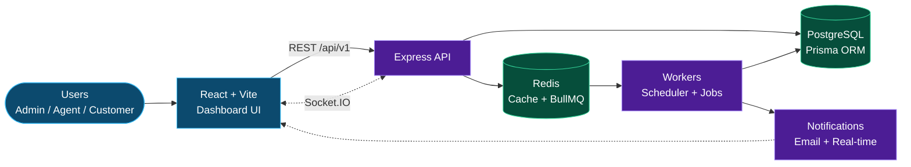

<div align="center">

<h1>ISPFlow</h1>

<p><b>ISP Automation &amp; Network Operations Platform</b></p>

<a href="https://github.com/Shivanand8546/ISP-Automation-System">
  
</a>

<br/>


[Features](#features) · [Architecture](#architecture) · [Getting Started](#getting-started) · [API](#api-overview)

</div>

---

ISPFlow is a full-stack platform for running an Internet Service Provider. It brings customer management, plans, subscriptions, billing, support tickets, technician jobs, network monitoring and incident handling into one place, and automates the repetitive work (expiry checks, reminders, SLA escalation, device monitoring) with background workers.

## Features

- **Customers & connections** – manage customer records and their service connections.
- **Plans & subscriptions** – create plans, track subscription lifecycle and history, automatic expiry checks and renewal reminders.
- **Billing** – payments, invoices, idempotent payment requests, webhook handling. Supports a built-in mock provider for development and Razorpay for real payments (UPI details are configurable).
- **Support tickets** – priorities, categories, comments, assignment, escalation and SLA tracking (configurable SLA hours per priority).
- **Technicians & installations** – assign jobs, track installation status.
- **Network monitoring** – devices, interfaces and metrics, with offline detection every 30 seconds.
- **Incidents** – open incidents by severity and post updates.
- **Notifications** – in-app and email (SMTP) notifications for payments, plan expiry, service changes and tickets.
- **Real-time updates** – Socket.IO with JWT-authenticated connections.
- **Audit logs** – track who did what.
- **Role-based access** – `SUPER_ADMIN`, `ISP_ADMIN`, `SUPPORT_AGENT`, `TECHNICIAN`, `CUSTOMER`.
- **Security basics** – Helmet, CORS allow-list, rate limiting (stricter on auth), JWT access/refresh tokens, bcrypt password hashing, Zod validation.

## Architecture



Requests flow from the React UI to the Express API, which reads and writes PostgreSQL through Prisma. Long-running and scheduled work is pushed to Redis-backed BullMQ queues and handled by workers, which in turn trigger notifications.

## Tech Stack

| Layer | Technology |
|---|---|
| Backend | Node.js, Express, TypeScript |
| Database | PostgreSQL 16 with Prisma ORM |
| Queue / Cache | Redis 7 with BullMQ |
| Real-time | Socket.IO |
| Payments | Razorpay (or mock provider) |
| Logging / Metrics | Pino, Prometheus client |
| Frontend | React 18, Vite, TypeScript |
| Frontend libs | React Router, TanStack Query, React Hook Form, Recharts, Axios, Lucide |
| Testing | Jest, Supertest |

## Project Structure

```
ISP-Automation-System/
├── backend/
│   ├── prisma/            # schema.prisma, migrations, bootstrap-admin script
│   ├── src/
│   │   ├── auth/          # login, tokens, sessions
│   │   ├── customers/  plans/  connections/  subscriptions/
│   │   ├── billing/       # payments, invoices, payment providers
│   │   ├── tickets/  technicians/  incidents/  network/
│   │   ├── notifications/  audit/  dashboard/
│   │   ├── queues/  workers/   # BullMQ queues, workers, scheduler
│   │   ├── websocket/     # Socket.IO server
│   │   ├── middleware/    # auth, error handler, idempotency
│   │   ├── config/  utils/
│   │   ├── app.ts         # Express app and route registration
│   │   └── server.ts      # entry point
│   └── tests/
├── frontend/
│   └── src/
│       ├── pages/         # Dashboard, Customers, Plans, Payments, Tickets, ...
│       ├── components/    # AppLayout, Sidebar, Topbar
│       ├── contexts/      # AuthContext
│       └── lib/api.ts     # API client
├── docker-compose.yml
└── README.md
```

## Getting Started

### Prerequisites

- Node.js 18+ (20+ recommended)
- npm
- Docker and Docker Compose (for PostgreSQL and Redis)

### 1. Clone the repository

```bash
git clone https://github.com/Shivanand8546/ISP-Automation-System.git
cd ISP-Automation-System
```

### 2. Configure environment

```bash
cp backend/.env.example backend/.env
```

Open `backend/.env` and set at least:

- `JWT_ACCESS_SECRET` and `JWT_REFRESH_SECRET` – use long random strings, not `change-me`.
- `DATABASE_URL` and `REDIS_URL` – defaults match the Docker Compose services.

### 3. Start PostgreSQL and Redis

```bash
docker compose up -d postgres redis
```

### 4. Install dependencies

```bash
cd backend && npm install
cd ../frontend && npm install
```

### 5. Run database migrations

```bash
cd backend
npx prisma migrate dev
```

### 6. Create the first administrator

Set these in `backend/.env`:

```env
BOOTSTRAP_ADMIN_NAME=Your Name
BOOTSTRAP_ADMIN_EMAIL=you@example.com
BOOTSTRAP_ADMIN_PASSWORD=a-unique-password-of-12-plus-chars
```

Then run:

```bash
cd backend
npm run db:bootstrap-admin
```

Keep these values private and never commit `.env`.

### 7. Start the app

```bash
# Terminal 1 – API (http://localhost:4000)
cd backend && npm run dev

# Terminal 2 – Web UI (http://localhost:5173)
cd frontend && npm run dev
```

Log in with the admin account you created in step 6.

> The app does not create demo accounts or sample data. Add real customers and service records through the UI or your own import process.

## Environment Variables

All variables live in `backend/.env` (see `backend/.env.example`).

| Variable | Purpose |
|---|---|
| `PORT`, `NODE_ENV` | Server port (default `4000`) and environment |
| `DATABASE_URL` | PostgreSQL connection string |
| `REDIS_URL` | Redis connection string |
| `JWT_ACCESS_SECRET`, `JWT_REFRESH_SECRET` | Token signing secrets |
| `JWT_ACCESS_EXPIRY`, `JWT_REFRESH_EXPIRY` | Token lifetimes (default `15m` / `7d`) |
| `CORS_ORIGINS` | Comma-separated allowed origins |
| `PAYMENT_PROVIDER` | `MOCK` (default) or Razorpay |
| `RAZORPAY_KEY_ID`, `RAZORPAY_KEY_SECRET`, `RAZORPAY_WEBHOOK_SECRET` | Razorpay credentials |
| `UPI_ID`, `UPI_PAYEE_NAME` | UPI payment details |
| `PAYMENT_PENDING_EXPIRY_MINUTES` | How long a pending payment stays valid |
| `SMTP_HOST`, `SMTP_PORT`, `SMTP_USER`, `SMTP_PASSWORD`, `SMTP_FROM` | Email delivery |
| `APP_URL`, `FRONTEND_URL` | Public URLs of the API and web app |
| `RATE_LIMIT_WINDOW_MS`, `RATE_LIMIT_MAX`, `AUTH_RATE_LIMIT_MAX` | Rate limiting |
| `IDEMPOTENCY_KEY_TTL_HOURS` | Idempotency key retention |
| `MONITOR_INTERVAL_MS`, `DEVICE_OFFLINE_THRESHOLD_MS` | Network monitoring timing |
| `SLA_LOW`, `SLA_MEDIUM`, `SLA_HIGH`, `SLA_CRITICAL` | Ticket SLA targets in hours |
| `BOOTSTRAP_ADMIN_*` | One-time first admin creation |

## API Overview

Base path: `/api/v1`

| Route | Description |
|---|---|
| `/auth` | Login, logout, token refresh |
| `/customers` | Customer management |
| `/plans` | Internet plans |
| `/connections` | Service connections |
| `/subscriptions` | Subscriptions and history |
| `/payments` | Payments and provider webhook |
| `/invoices` | Invoices |
| `/tickets` | Support tickets |
| `/technicians` | Technicians and jobs |
| `/network/devices` | Network devices and metrics |
| `/incidents` | Network incidents |
| `/notifications` | Notifications |
| `/dashboard` | Dashboard statistics |
| `/audit-logs` | Audit trail |

Health endpoints: `GET /health` (liveness) and `GET /ready` (checks PostgreSQL and Redis).

## Background Automation

A BullMQ scheduler runs these jobs automatically:

| Job | Frequency |
|---|---|
| Subscription expiry check | Every minute |
| Renewal reminders | Every hour |
| Device monitoring | Every 30 seconds |
| Ticket SLA check | Every 15 minutes |
| Idempotency key cleanup | Every hour |

## Development Commands

```bash
# Backend
cd backend
npm run dev              # start with auto-reload
npm run build            # compile TypeScript
npm start                # run compiled build
npm test                 # run Jest tests
npx tsc --noEmit         # type-check only
npm run db:studio        # open Prisma Studio
npm run db:migrate:deploy  # apply migrations (production)

# Frontend
cd frontend
npm run dev              # Vite dev server
npm run build            # type-check and production build
```

## Docker Compose Profiles

`docker-compose.yml` defines the following services:

- **Default:** `postgres`, `redis`
- **`full` profile:** `backend`, `frontend` (containerised app)
- **`monitoring` profile:** `prometheus`, `grafana`

```bash
docker compose --profile full up -d
docker compose --profile monitoring up -d
```

> Note: the `full` profile expects `backend/Dockerfile`, `frontend/Dockerfile` and `backend/.env.docker`, and the `monitoring` profile expects `monitoring/prometheus.yml`. Add these files before using those profiles. Also change the default Grafana admin password before any shared deployment.

## Security Notes

- Never commit `.env` or `.env.docker`.
- Replace all default secrets and database credentials outside local development.
- Use `PAYMENT_PROVIDER` with real Razorpay credentials only in production; the mock provider is for development.

## Contributing

1. Fork the repository and create a feature branch.
2. Make your changes with tests where relevant.
3. Run `npx tsc --noEmit` and `npm test` in `backend`, and `npm run build` in `frontend`.
4. Open a pull request describing the change.

## License

No license has been specified yet. Add a `LICENSE` file to define how others may use this project.
